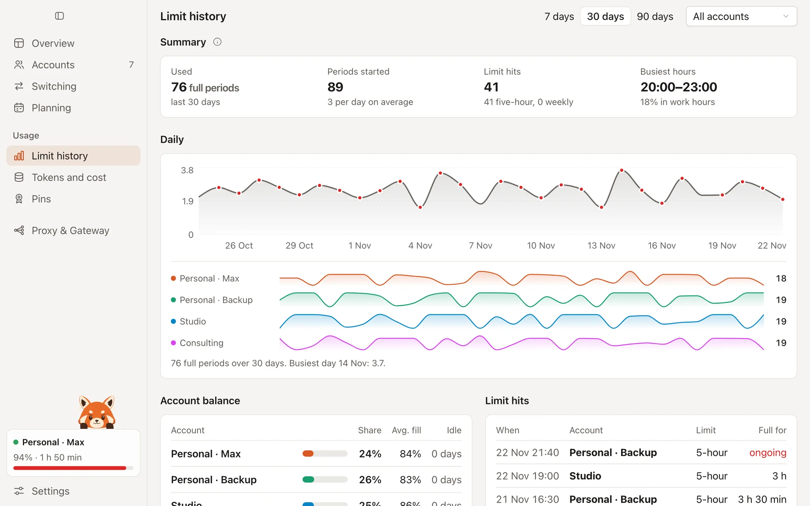

<div align="center">


# Relay

**Todas tus cuentas de Claude, una sola app en la barra de menús.**<br>
Cambia Claude Desktop entre cuentas, conserva tu historial de Claude Code en todas ellas,<br>
ve de un vistazo cada límite de 5 horas y semanal, y deja que una pasarela local reparta el trabajo.

[](https://github.com/ahmetcankacar54/relay/releases/latest)
[](https://github.com/ahmetcankacar54/relay/releases)
[](https://github.com/ahmetcankacar54/relay/actions/workflows/check.yml)
[](#instalación)
[](#plataformas)
[](#15-idiomas)
[](LICENSE)

[English](README.md) · [Türkçe](README.tr.md) · [简体中文](README.zh-CN.md) · [日本語](README.ja.md) · [한국어](README.ko.md) · **Español**

*Esta es una traducción; el README en inglés es la fuente y puede estar más actualizado.*

[Descargar](#instalación) · [Funciones](#funciones) · [Privacidad](#privacidad-y-seguridad) · [Términos y riesgos](#términos-y-riesgos) · [Preguntas frecuentes](#preguntas-frecuentes) · [CLI](cli/README.md)

<br>

<picture>
  <source media="(prefers-color-scheme: dark)" srcset="docs/images/overview-dark.webp">
  
</picture>

</div>

## Por qué Relay

Si tienes más de un plan de Claude (por ejemplo, un Pro o Max personal y un puesto Team o Enterprise de tu empresa), la app de Claude solo conoce uno a la vez. Cerrar sesión y volver a entrar lleva minutos, pierde las conversaciones de la pestaña Code y nunca sabes qué cuenta todavía tiene margen.

Relay lo resuelve desde la barra de menús:

- **Cambio con un clic.** Relay cierra la app de Claude, restaura la sesión guardada de la otra cuenta y la vuelve a abrir. Nada que volver a escribir, sin idas y vueltas por el navegador.
- **Tu historial de Code te acompaña.** Las conversaciones y los proyectos de Claude Code se combinan entre las cuentas que elijas, así que la misma conversación está ahí después de cada cambio, con su modo de permisos.
- **Todos los límites, todas las cuentas.** Límites de 5 horas, semanales y por modelo (Opus, Fable) con sus horas de reinicio, para cuentas de Claude, OpenAI Codex y Google Antigravity, actualizados en segundo plano.
- **Un plan para tu día.** Relay escalona los periodos de 5 horas de cada cuenta a lo largo de tu horario de trabajo, para que la siguiente cuenta esté lista antes de que se agote la actual.
- **Una pasarela que gasta la cuenta adecuada.** Apunta Claude Code, Codex CLI u omp a una sola dirección local; cada solicitud va a la cuenta que tiene margen, y las sesiones y cachés se quedan en su cuenta. Está desactivada por defecto; lee [Términos y riesgos](#términos-y-riesgos) antes de activarla.

Relay es gratuito, de código abierto (MIT), funciona por completo en tu Mac y no envía nada a nadie aparte de los servicios que ya usas.

## Instalación

| Plataforma | Descarga | Notas |
| --- | --- | --- |
| **macOS 13+** (Apple silicon) | [`Relay-<version>-arm64.dmg`](https://github.com/ahmetcankacar54/relay/releases/latest) | La plataforma principal: panel de la barra de menús, widget, cambio automático. |
| **Windows 10/11** (x64) | [`Relay-Setup-<version>-x64.exe`](https://github.com/ahmetcankacar54/relay/releases/latest) | Cambio manual, límites, cuentas, pasarela. Experimental: aún no probado en una máquina real. |
| **Linux** (x64) | [`Relay-<version>-x86_64.AppImage`](https://github.com/ahmetcankacar54/relay/releases/latest) | Funciona con el Claude Desktop oficial para Linux. |
| **CLI** (macOS) | `npm i -g @ahmetcankacar/relay` | `relay switch`, `relay usage`, `relay run` … consulta la [guía de la CLI](cli/README.md). |

Cada versión incluye un `SHA256SUMS.txt` y se actualiza sola desde GitHub Releases.

> [!IMPORTANT]
> **Relay está firmado con el certificado propio del autor, pero Apple no lo ha notarizado.** La primera vez que lo abras, macOS lo bloqueará una vez:
> 1. Arrastra **Relay** desde el DMG a **Aplicaciones** y ábrelo desde ahí.
> 2. Cuando macOS diga que no puede verificar Relay, haz clic en **OK**.
> 3. Abre **Ajustes del Sistema → Privacidad y seguridad**, busca el aviso de que se bloqueó Relay y haz clic en **Abrir igualmente**.
>
> Esto hace falta una vez por versión. Si macOS sigue preguntando, ejecuta `xattr -dr com.apple.quarantine /Applications/Relay.app`. La guía completa está en [INSTALL.txt](docs/share/install-notes.md).

## Inicio rápido

| Tienes | Haz esto |
| --- | --- |
| La app de Claude con sesión iniciada en una cuenta | **Cuentas → Añadir cuenta**. Relay guarda esa sesión y también encuentra las sesiones de Codex CLI en este Mac. |
| Otra cuenta de Claude | **Añadir cuenta → Iniciar sesión con otra cuenta de Claude**. La app de Claude se abre en su pantalla de inicio de sesión; inicia sesión y abre Code una vez, y Relay la guarda por sí solo. |
| Cuentas añadidas | Haz clic en **Cambiar** junto a una cuenta en la barra de menús o en el Resumen. |
| Varias cuentas y una jornada de trabajo | **Planificación** → elige las cuentas y tu horario de trabajo. |
| Claude Code o Codex CLI en una terminal | **Proxy y pasarela → Herramientas → Conectar** los dirige a la pasarela con un clic (y los devuelve). |

## Funciones

### Cuentas, agrupadas como tú piensas

<picture>
  <source media="(prefers-color-scheme: dark)" srcset="docs/images/accounts-dark.webp">
  
</picture>

- Cuentas de Claude, OpenAI Codex y Google Antigravity en una sola lista, agrupadas por proveedor y grupo de trabajo, ordenadas por nombre, uso de 5 horas o próximo reinicio; los grupos contraídos se recuerdan.
- Un estado por cuenta (Lista, En uso, Casi agotado, Datos de uso desactualizados…) y como mucho una acción: cambiar, actualizar o volver a conectar.
- Las conexiones de cada cuenta en un solo lugar: la sesión de la app de Claude, la sesión de uso, la extensión de navegador de Claude y el `claude` de la terminal.

### Cambios que conservan tu trabajo

- **Cambia** desde la barra de menús, la ventana, el widget o la CLI. Es un reinicio limpio de la app de Claude, tras una copia de seguridad cifrada de los archivos que modifica; un cambio interrumpido se puede restaurar.
- **Historial de Code compartido**: las conversaciones y los proyectos locales de las cuentas que elijas (también entre empresas) se combinan en cada cambio. Las conversaciones eliminadas siguen eliminadas; el modo de permisos Bypass nunca se traslada.
- **Cambio automático** (opcional): cuando cierras la app de Claude, o —experimental, macOS— cuando la cuenta activa llega a su límite, Relay elige la cuenta con más margen utilizable, cambia una vez y envía un mensaje de continuación a cada conversación que se detuvo.
- Los borradores que dejaste sin enviar en la app de Claude se guardan al cambiar, listos para copiarlos de vuelta (en macOS, Relay puede volver a escribirlos por ti; experimental).

### Límites, historial y costo

<picture>
  <source media="(prefers-color-scheme: dark)" srcset="docs/images/limits-dark.webp">
  
</picture>

- Uso de 5 horas y semanal con horas de reinicio, límites por modelo, planes (Pro, Max 5×, Max 20×, Team, Enterprise, ChatGPT Plus, Google AI Pro) y una marca de ritmo en cada barra.
- **Historial de límites**: periodos completos usados, límites alcanzados, cuándo trabajas y con qué equilibrio se reparten la carga tus cuentas.
- **Tokens y coste**: tokens de Claude Code por día, modelo y cuenta, valorados a los precios de lista de la API.

### Un planificador para los periodos de 5 horas

<picture>
  <source media="(prefers-color-scheme: dark)" srcset="docs/images/planning-dark.webp">
  
</picture>

- Relay simula tu día a partir del ritmo que aprendió y del tamaño de cada plan (un Max 20× cuenta como 20 veces un Pro), y luego elige horas de inicio que dejen el menor número de huecos con el menor número de cambios, repartidas a lo largo del día.
- **Inicio anticipado** (opcional, macOS y Linux) abre el periodo de cada cuenta antes de empezar a trabajar para que se reinicie cuando lo necesites, y lo mantiene en marcha durante tu horario.
- El plan se adapta durante el día cuando trabajas más rápido o más despacio de lo habitual, y sabe cuándo se agota la semana de una cuenta.

### Una pasarela para todas tus herramientas de código

<picture>
  <source media="(prefers-color-scheme: dark)" srcset="docs/images/proxy-dark.webp">
  
</picture>

- Un endpoint local, protegido con clave, para Claude Code, Codex CLI y omp. Las solicitudes van a la cuenta cuya semana termina antes y que todavía tiene margen, comparado en capacidad real (un Max 20× al 85 % todavía tiene más margen que un Pro recién reiniciado).
- Las sesiones se quedan en su cuenta y en su caché de prompts; una cuenta ocupada se vacía al inicio de un prompt, no a mitad.
- Solo escucha en este Mac, o en tu red de Tailscale si así lo eliges.
- Desactivada hasta que la actives. Es la parte de Relay más alejada del uso ordinario; consulta [Términos y riesgos](#términos-y-riesgos).

### Barra de menús, widget y CLI


- **Panel de la barra de menús**: la cuenta en uso, sus límites, la siguiente cuenta sugerida y un cambio con un clic. Elige qué muestra el título de la barra de menús (uso de 5 horas, tiempo restante, tokens o valor API de hoy).
- **Widgets de escritorio** (macOS): tu cuenta, todas las cuentas, hoy y los últimos 7 días.
- **CLI `relay`**: `relay status`, `relay switch work`, `relay usage`, `relay run work` (Claude Code con esa cuenta), `relay tokens`, `relay proxy start`. `--json` para scripts.
- Todo se maneja bien con el teclado: ⌘1–⌘8 para las páginas, ⌘K para buscar cuentas, flechas para recorrer las listas.

<br clear="right">

### 15 idiomas


English, Türkçe, Deutsch, Français, Español, Português (Brasil), Italiano, 日本語, 한국어, 简体中文, 繁體中文, Русский, Українська, Polski y Nederlands, en la app, la barra de menús, el widget y la CLI. Relay sigue el idioma de tu sistema hasta que elijas uno en **Ajustes → General**.

## Plataformas

| | macOS | Windows | Linux |
| --- | :---: | :---: | :---: |
| Cambiar la app de Claude entre cuentas | ✅ | ✅ | ✅ |
| Historial de Claude Code compartido | ✅ | ✅ | ✅ |
| Límites, historial, tokens y costo | ✅ | ✅ | ✅ |
| Pasarela para Claude Code / Codex CLI / omp | ✅ | ✅ | ✅ |
| Planificador | ✅ | ✅ | ✅ |
| Inicio anticipado de los periodos de 5 horas | ✅ | — | ✅ |
| Cambio automático al cerrar la app de Claude | ✅ | — | ✅ |
| Cambiar y continuar al llegar al límite (experimental) | ✅ | — | — |
| Panel de la barra de menús, widget, CLI `relay` | ✅ | — | — |

macOS es la plataforma principal. La versión para Windows todavía no se ha probado en una máquina real; los informes son bienvenidos.

## Privacidad y seguridad

- **Solo local.** Relay no tiene cuenta, ni servidor, ni **telemetría ni analíticas**. Sus datos están en `~/Library/Application Support/Relay` (macOS) o en `~/.config/Relay` (Linux).
- **Con quién se comunica:** con los servicios que tus cuentas ya usan —`claude.ai`, `api.anthropic.com` (uso y perfil), `chatgpt.com` / `api.openai.com` (Codex), `cloudcode-pa.googleapis.com` (Antigravity)—, con `api.github.com` para sus propias actualizaciones y, una sola vez al añadir una cuenta de Antigravity, con `github.com` para descargar un asistente de versión fija (CLIProxyAPI) cuyo SHA-256 se comprueba.
- **Las credenciales** nunca llegan a la interfaz. Las sesiones guardadas de la app de Claude se cifran con una clave guardada en el Llavero de macOS (Keychain), o en Secret Service o KWallet en Linux. Los archivos que contienen la clave de la pasarela se escriben para que solo tú puedas leerlos.
- **Los archivos de la app de Claude** solo se modifican mientras está cerrada, tras una copia de seguridad cifrada y un registro de escritura.
- **App reforzada:** ventanas de renderizado en sandbox, sin herramientas de desarrollo en las versiones publicadas, solo las propias páginas de Relay pueden llamar a la app, y una política de seguridad de contenido estricta.

¿Encontraste un problema? Infórmalo en privado; consulta [SECURITY.md](SECURITY.md).

## Términos y riesgos

Relay no es oficial, y parte de lo que hace no es la forma en que Anthropic quiere que las herramientas de terceros usen las sesiones de Claude. Lee esto antes de depender de él.

- **Qué dicen los términos de Anthropic.** La [página legal y de cumplimiento de Claude Code](https://code.claude.com/docs/en/legal-and-compliance#authentication-and-credential-use) dice que las sesiones de suscripción (Free, Pro, Max, Ultra) son para el uso ordinario de Claude Code y de las apps propias de Anthropic; que las herramientas de terceros no deben almacenar, enrutar ni intermediar esas sesiones; y que los límites anunciados presuponen un uso ordinario e individual. Anthropic dice que puede hacer cumplir esto sin previo aviso.
- **Qué hace Relay.** Relay guarda las sesiones de tus cuentas en tu equipo, cifradas, para poder cambiar la app de Claude y leer los límites. La pasarela va más allá: envía solicitudes de Claude Code a tus cuentas con esas sesiones y, cuando omp está conectado, las solicitudes de omp llegan a Claude con la misma forma que las de Claude Code.
- **Qué puede pasar.** Anthropic puede bloquear esas solicitudes, o limitar o suspender una cuenta que las use. Relay no puede impedirlo, y lo usas bajo tu propio riesgo (consulta la [licencia](LICENSE)).
- **Dónde está el riesgo.** Cambiar la app de Claude y leer los límites es lo más cercano al uso ordinario. La pasarela está más lejos, y omp a través de una cuenta de Claude es lo más lejano. La pasarela está desactivada hasta que la actives; déjala desactivada si prefieres no asumir ese riesgo.
- **Cuentas de trabajo.** Un puesto Team o Enterprise también se rige por el acuerdo de tu empresa con Anthropic. Pregunta a tu administrador antes de añadirlo, y usa solo cuentas que sean tuyas.

**Google Antigravity.** Las [preguntas frecuentes de Antigravity](https://antigravity.google/docs/faq) de Google dicen que acceder a Antigravity con software de terceros infringe sus términos y puede llevar a la suspensión de la cuenta, y que la rotación automática de cuentas no se admite en los planes de consumo; Google suspendió cuentas por ello en febrero de 2026. Relay es software de terceros en ese sentido: inicia sesión en Antigravity y lee sus límites, y su pasarela puede enviar solicitudes a través de cuentas de Antigravity. Por eso una cuenta de Antigravity en Relay conlleva el mayor riesgo. Relay cambia la app de Antigravity solo cuando tú lo pides. Las cuentas de Codex se rigen por los términos de OpenAI.

## Preguntas frecuentes

<details>
<summary><b>¿Relay combina o amplía mi cuota?</b></summary>

No. Cada cuenta conserva sus propios límites; Relay solo cambia qué cuenta usa la app de Claude (o una solicitud que pasa por la pasarela) y te ayuda a aprovechar bien el tiempo de cada una. Usa solo cuentas que tengas permiso para usar, y lee primero [Términos y riesgos](#términos-y-riesgos).
</details>

<details>
<summary><b>¿Relay lo hace Anthropic?</b></summary>

No. Relay es una herramienta independiente y no oficial. No está afiliada a Anthropic, OpenAI ni Google, ni cuenta con su respaldo o patrocinio. Claude es una marca comercial de Anthropic.
</details>

<details>
<summary><b>¿Cambiar de cuenta interrumpe una respuesta en curso?</b></summary>

Un cambio reinicia la app de Claude, así que una respuesta o un subagente que siga en marcha se detiene. Relay pregunta primero, y el cambio automático solo actúa cuando no hay nada en marcha. Las conversaciones en sí se conservan y continúan después del cambio.
</details>

<details>
<summary><b>¿Por qué macOS dice que no puede verificar Relay?</b></summary>

Apple todavía no ha notarizado Relay. Sigue los tres pasos de [Instalación](#instalación) una vez por versión. Las actualizaciones se comprueban con el certificado propio de Relay, así que una actualización manipulada se rechaza.
</details>

<details>
<summary><b>¿Puede una actualización de la app de Claude romper Relay?</b></summary>

Puede: Relay lee los archivos locales de la app de Claude y, para la continuación automática, su árbol de accesibilidad. Relay comprueba lo que encuentra antes de cambiar nada, guarda una copia de seguridad, y un cambio interrumpido se puede restaurar desde la app.
</details>

<details>
<summary><b>¿Cómo lo desinstalo?</b></summary>

Cierra Relay desde la barra de menús, mueve `Relay.app` a la Papelera y elimina `~/Library/Application Support/Relay` si también quieres borrar tus sesiones guardadas. La app de Claude se queda con la última cuenta a la que se cambió.
</details>

## Compilar desde el código fuente

Requisitos: Node.js 22.12+ y, en macOS, las Xcode Command Line Tools.

```sh
npm ci
npm run dev        # Electron + Vite
npm run dev:ui     # vista previa en el navegador con cuentas de ejemplo (?demo=50 para cincuenta)
npm test           # más de 3000 pruebas
npm run dist:mac:local   # compilación local firmada (consulta docs/macos-local-signing.md)
```

Cómo funcionan el cambio, la combinación del historial y la lectura del uso, la firma y los detalles de Linux están en [docs/development.md](docs/development.md) (en inglés). Las contribuciones son bienvenidas: informes de errores, traducciones y pull requests por igual. Los textos siguen [docs/ux/glossary.md](docs/ux/glossary.md); cada texto de la interfaz está en [`shared/i18n/catalogs`](shared/i18n/catalogs).

## Historial de estrellas

<a href="https://star-history.com/#ahmetcankacar54/relay&Date">
  <picture>
    <source media="(prefers-color-scheme: dark)" srcset="https://api.star-history.com/svg?repos=ahmetcankacar54/relay&type=Date&theme=dark">
    
  </picture>
</a>

## Licencia

[MIT](LICENSE) © Ahmet Can Kaçar. Relay es un proyecto independiente y no está afiliado a Anthropic, OpenAI ni Google.
