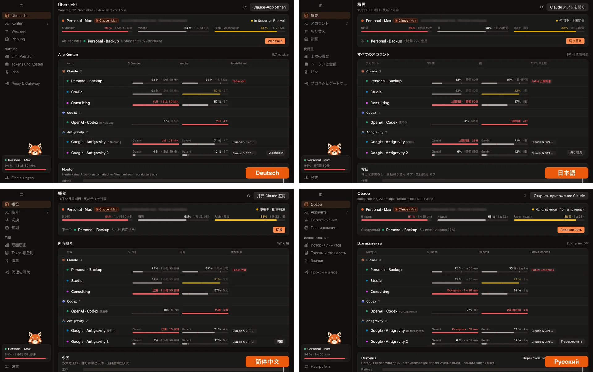

<div align="center">


# Relay

**모든 Claude 계정을 하나의 메뉴 막대 앱에서.**<br>
Claude Desktop을 계정 사이에서 전환하고, 모든 계정에서 Claude Code 기록을 유지하고,<br>
모든 5시간 한도와 주간 한도를 한눈에 확인하고, 로컬 게이트웨이가 작업을 나눠 맡게 합니다.

[](https://github.com/ahmetcankacar54/relay/releases/latest)
[](https://github.com/ahmetcankacar54/relay/releases)
[](https://github.com/ahmetcankacar54/relay/actions/workflows/check.yml)
[](#설치)
[](#플랫폼)
[](#15개-언어)
[](LICENSE)

[English](README.md) · [Türkçe](README.tr.md) · [简体中文](README.zh-CN.md) · [日本語](README.ja.md) · **한국어** · [Español](README.es.md)

*이 문서는 번역본입니다. 원본은 영어 README이며, 영어 README가 더 최신일 수 있습니다.*

[다운로드](#설치) · [기능](#기능) · [개인정보](#개인정보-보호-및-보안) · [약관과 위험](#약관과-위험) · [FAQ](#faq) · [CLI](cli/README.md)

<br>

<picture>
  <source media="(prefers-color-scheme: dark)" srcset="docs/images/overview-dark.webp">
  
</picture>

</div>

## 왜 Relay인가

Claude 요금제가 두 개 이상이라면(예: 개인 Pro나 Max와 회사의 Team 또는 Enterprise 시트) Claude 앱은 한 번에 그중 하나만 인식합니다. 로그아웃했다가 다시 로그인하면 몇 분이 걸리고, Code 탭의 대화가 사라지며, 어느 계정에 아직 여유가 있는지도 알 수 없습니다.

Relay는 메뉴 막대에서 이 문제를 해결합니다.

- **클릭 한 번으로 전환.** Relay가 Claude 앱을 종료하고, 다른 계정의 저장된 로그인을 되돌려 놓은 뒤 다시 엽니다. 다시 입력할 것도, 브라우저를 오갈 일도 없습니다.
- **Code 기록이 함께 따라옵니다.** 선택한 계정들의 Claude Code 대화와 프로젝트가 병합되므로, 전환할 때마다 같은 대화가 권한 모드와 함께 그대로 남아 있습니다.
- **모든 계정의 모든 한도.** Claude, OpenAI Codex, Google Antigravity 계정의 5시간 한도, 주간 한도, 모델별(Opus, Fable) 한도를 초기화 시각과 함께 보여 주며, 백그라운드에서 새로고침합니다.
- **하루를 위한 계획.** Relay는 각 계정의 5시간 주기를 업무 시간에 걸쳐 엇갈리게 배치해, 현재 계정이 소진되기 전에 다음 계정이 준비되도록 합니다.
- **알맞은 계정을 쓰는 게이트웨이.** Claude Code, Codex CLI 또는 omp가 하나의 로컬 주소를 가리키게 하면, 각 요청은 여유가 있는 계정으로 가고 세션과 캐시는 각자의 계정에 머뭅니다. 기본값은 꺼짐이며, 켜기 전에 [약관과 위험](#약관과-위험)을 읽어 주세요.

Relay는 무료 오픈 소스(MIT)이며, 전적으로 사용자의 Mac에서 실행되고, 이미 사용 중인 서비스 외에는 누구에게도 아무것도 보내지 않습니다.

## 설치

| 플랫폼 | 다운로드 | 참고 |
| --- | --- | --- |
| **macOS 13+** (Apple silicon) | [`Relay-<version>-arm64.dmg`](https://github.com/ahmetcankacar54/relay/releases/latest) | 주요 플랫폼: 메뉴 막대 패널, 위젯, 자동 전환. |
| **Windows 10/11** (x64) | [`Relay-Setup-<version>-x64.exe`](https://github.com/ahmetcankacar54/relay/releases/latest) | 수동 전환, 한도, 계정, 게이트웨이. |
| **Linux** (x64) | [`Relay-<version>-x86_64.AppImage`](https://github.com/ahmetcankacar54/relay/releases/latest) | Linux용 공식 Claude Desktop과 함께 작동합니다. |
| **CLI** (macOS) | `npm i -g @ahmetcankacar/relay` | `relay switch`, `relay usage`, `relay run` … [CLI 가이드](cli/README.md)를 참고하세요. |

모든 릴리스에는 `SHA256SUMS.txt`가 포함되며, Relay는 GitHub Releases에서 스스로 업데이트합니다.

> [!IMPORTANT]
> **Relay는 개발자 본인의 인증서로 서명되어 있지만 Apple의 공증(notarization)을 받지 않았습니다.** 처음 열 때 macOS가 한 번 차단합니다.
> 1. DMG에서 **Relay**를 **응용 프로그램** 폴더로 드래그한 뒤 그곳에서 엽니다.
> 2. macOS가 Relay를 확인할 수 없다고 하면 **완료**를 클릭합니다.
> 3. **시스템 설정 → 개인정보 보호 및 보안**을 열고 "Relay이(가) 차단되었습니다" 항목을 찾아 **그래도 열기**를 클릭합니다.
>
> 이 과정은 버전마다 한 번 필요합니다. macOS가 계속 묻는다면 `xattr -dr com.apple.quarantine /Applications/Relay.app`을 실행하세요. 전체 안내는 [INSTALL.txt](docs/share/install-notes.md)에 있습니다.

## 빠른 시작

| 상황 | 할 일 |
| --- | --- |
| 한 계정으로 로그인된 Claude 앱 | **계정 → 계정 추가**. Relay가 그 로그인을 저장하고, 이 Mac에 있는 Codex CLI 로그인도 찾아냅니다. |
| 다른 Claude 계정 | **계정 추가 → 다른 Claude 계정으로 로그인**. Claude 앱이 로그인 화면으로 열립니다. 로그인한 뒤 Code를 한 번 열면 Relay가 알아서 저장합니다. |
| 계정을 추가한 뒤 | 메뉴 막대나 개요에서 계정 옆의 **전환**을 클릭합니다. |
| 여러 계정과 하루 업무 | **계획** → 계정과 업무 시간을 선택합니다. |
| 터미널의 Claude Code 또는 Codex CLI | **프록시 및 게이트웨이 → 도구 → 연결**로 클릭 한 번에 게이트웨이를 가리키게 합니다(되돌리기도 가능). |

## 기능

### 생각하는 방식대로 묶이는 계정

<picture>
  <source media="(prefers-color-scheme: dark)" srcset="docs/images/accounts-dark.webp">
  
</picture>

- Claude, OpenAI Codex, Google Antigravity 계정을 하나의 목록에서 제공업체와 업무 그룹별로 묶고, 이름, 5시간 사용량 또는 다음 초기화 순으로 정렬합니다. 접어 둔 그룹은 기억됩니다.
- 계정마다 하나의 상태(준비됨, 사용 중, 거의 소진, 사용량 데이터가 오래됨…)와 최대 하나의 작업(전환, 새로고침 또는 다시 연결)만 표시합니다.
- 각 계정의 연결을 한곳에서 봅니다: Claude 앱 로그인, 사용량 로그인, Claude 브라우저 확장 프로그램, 터미널의 `claude`.

### 작업을 지키는 전환

- 메뉴 막대, 창, 위젯 또는 CLI에서 **전환**합니다. 전환은 Claude 앱이 변경하는 파일을 암호화해 백업한 뒤 Claude 앱을 깨끗하게 다시 시작하는 방식이며, 중단된 전환은 복원할 수 있습니다.
- **공유 Code 기록**: 선택한 계정들(회사가 달라도 됩니다)의 대화와 로컬 프로젝트가 전환할 때마다 병합됩니다. 삭제한 대화는 삭제된 상태로 유지되며, Bypass 권한 모드는 절대 옮겨지지 않습니다.
- **자동 전환**(선택 사항): Claude 앱을 종료할 때, 또는 활성 계정이 한도에 도달할 때(실험적 기능, macOS) Relay가 사용할 수 있는 여유가 가장 많은 계정을 골라 한 번 전환하고, 멈춘 각 대화에 이어 가기 메시지를 하나씩 보냅니다.
- Claude 앱에서 보내지 않고 남겨 둔 초안은 전환 시 저장되어 다시 복사할 수 있습니다(macOS에서는 Relay가 대신 다시 입력해 줄 수도 있습니다 — 실험적 기능).

### 한도, 기록, 비용

<picture>
  <source media="(prefers-color-scheme: dark)" srcset="docs/images/limits-dark.webp">
  
</picture>

- 초기화 시각이 포함된 5시간·주간 사용량, 모델별 한도, 요금제(Pro, Max 5×, Max 20×, Team, Enterprise, ChatGPT Plus, Google AI Pro), 그리고 모든 막대에 표시되는 속도 표시.
- **한도 기록**: 끝까지 사용한 주기, 한도 도달, 작업하는 시간대, 계정들이 부하를 얼마나 고르게 나누는지.
- **토큰과 비용**: 일별, 모델별, 계정별 Claude Code 토큰을 API 정가로 계산합니다.

### 5시간 주기를 위한 플래너

<picture>
  <source media="(prefers-color-scheme: dark)" srcset="docs/images/planning-dark.webp">
  
</picture>

- Relay는 학습한 사용 속도와 각 요금제의 크기(Max 20×는 Pro의 20배로 계산)로 하루를 시뮬레이션한 뒤, 가장 적은 전환으로 빈틈이 가장 적게 생기도록 하루에 걸쳐 분산된 시작 시각을 고릅니다.
- **미리 시작**(선택 사항, macOS와 Linux)은 업무 전에 각 계정의 주기를 열어 필요한 때에 초기화되게 하고, 업무 시간 동안 주기가 계속 진행되게 합니다.
- 평소보다 빠르거나 느리게 작업하면 계획이 하루 중에 조정되며, 계정의 주간 한도가 언제 소진되는지도 반영합니다.

### 모든 코딩 도구를 위한 하나의 게이트웨이

<picture>
  <source media="(prefers-color-scheme: dark)" srcset="docs/images/proxy-dark.webp">
  
</picture>

- Claude Code, Codex CLI, omp를 위한 키로 보호되는 로컬 엔드포인트입니다. 요청은 주간 주기가 가장 먼저 끝나면서 아직 여유가 있는 계정으로 가며, 여유는 실제 용량으로 비교합니다(85% 사용한 Max 20×가 새로 시작한 Pro보다 여유가 더 많습니다).
- 세션은 자신의 계정과 그 프롬프트 캐시에 머물고, 바빠진 계정은 프롬프트 도중이 아니라 프롬프트가 시작될 때 비워집니다.
- 이 Mac에서만, 또는 원하면 Tailscale 네트워크에서만 수신합니다.
- 직접 켜기 전까지는 꺼져 있습니다. Relay에서 일반적인 사용과 가장 거리가 먼 부분이므로 [약관과 위험](#약관과-위험)을 참고하세요.

### 메뉴 막대, 위젯, CLI


- **메뉴 막대 패널**: 사용 중인 계정, 그 계정의 한도, 추천하는 다음 계정, 클릭 한 번으로 전환. 메뉴 막대 제목에 표시할 내용(5시간 사용량, 남은 시간, 오늘의 토큰 또는 API 환산액)을 고를 수 있습니다.
- **데스크톱 위젯**(macOS): 내 계정, 모든 계정, 오늘, 최근 7일.
- **`relay` CLI**: `relay status`, `relay switch work`, `relay usage`, `relay run work`(해당 계정으로 Claude Code 실행), `relay tokens`, `relay proxy start`. 스크립트용 `--json`.
- 모든 기능을 키보드로 쓸 수 있습니다: 페이지는 ⌘1–⌘8, 계정 검색은 ⌘K, 목록 이동은 화살표 키.

<br clear="right">

### 15개 언어



English, Türkçe, Deutsch, Français, Español, Português (Brasil), Italiano, 日本語, 한국어, 简体中文, 繁體中文, Русский, Українська, Polski, Nederlands — 앱, 메뉴 막대, 위젯, CLI에서 모두 지원합니다. **설정 → 일반**에서 언어를 고르기 전까지 Relay는 시스템 언어를 따릅니다.

## 플랫폼

| | macOS | Windows | Linux |
| --- | :---: | :---: | :---: |
| 계정 사이에서 Claude 앱 전환 | ✅ | ✅ | ✅ |
| 공유 Claude Code 기록 | ✅ | ✅ | ✅ |
| 한도, 기록, 토큰과 비용 | ✅ | ✅ | ✅ |
| Claude Code / Codex CLI / omp용 게이트웨이 | ✅ | ✅ | ✅ |
| 플래너 | ✅ | ✅ | ✅ |
| 5시간 주기 미리 시작 | ✅ | — | ✅ |
| Claude 앱 종료 시 자동 전환 | ✅ | — | ✅ |
| 한도 도달 시 전환 후 이어 가기(실험적 기능) | ✅ | — | — |
| 메뉴 막대 패널, 위젯, `relay` CLI | ✅ | — | — |

주요 플랫폼은 macOS입니다. Windows 빌드는 아직 실제 컴퓨터에서 테스트하지 않았습니다. 사용 후기를 환영합니다.

## 개인정보 보호 및 보안

- **로컬 전용.** Relay에는 계정도, 서버도, **원격 측정(telemetry)이나 분석도 없습니다**. 데이터는 `~/Library/Application Support/Relay`(macOS) 또는 `~/.config/Relay`(Linux)에 저장됩니다.
- **통신 대상:** 계정이 이미 사용하는 서비스 — `claude.ai`, `api.anthropic.com`(사용량과 프로필), `chatgpt.com` / `api.openai.com`(Codex), `cloudcode-pa.googleapis.com`(Antigravity) — 그리고 자체 업데이트를 위한 `api.github.com`.
- **자격 증명**은 UI에 전달되지 않습니다. 저장된 Claude 앱 로그인은 macOS 키체인(Linux에서는 Secret Service 또는 KWallet)에 보관된 키로 암호화됩니다. 게이트웨이 키가 들어 있는 파일은 본인만 읽을 수 있도록 기록됩니다.
- **Claude 앱의 파일**은 앱이 닫혀 있을 때만, 암호화된 백업과 쓰기 저널을 남긴 뒤에 변경합니다.
- **강화된 앱:** 샌드박스로 격리된 렌더러 창, 릴리스에는 개발자 도구 없음, Relay 자체 페이지만 앱 내부를 호출 가능, 엄격한 콘텐츠 보안 정책.

문제를 발견했나요? 비공개로 알려 주세요 — [SECURITY.md](SECURITY.md)를 참고하세요.

## 약관과 위험

Relay는 비공식 도구이며, Relay가 하는 일 중 일부는 Anthropic이 서드파티 도구에 원하는 Claude 로그인 사용 방식이 아닙니다. Relay에 의존하기 전에 이 내용을 읽어 주세요.

- **Anthropic 약관의 내용.** [Claude Code 법률 및 규정 준수 페이지](https://code.claude.com/docs/en/legal-and-compliance#authentication-and-credential-use)에 따르면 구독 로그인(Free, Pro, Max, Ultra)은 Claude Code와 Anthropic 자체 앱의 일반적인 사용을 위한 것이고, 서드파티 도구는 이러한 로그인을 저장하거나 라우팅하거나 중개해서는 안 되며, 공지된 한도는 일반적인 개인 사용을 전제로 합니다. Anthropic은 사전 통지 없이 이를 시행할 수 있다고 밝히고 있습니다.
- **Relay가 하는 일.** Relay는 Claude 앱을 전환하고 한도를 읽기 위해 계정들의 로그인을 사용자의 컴퓨터에 암호화해 보관합니다. 게이트웨이는 여기서 더 나아가, 그 로그인으로 Claude Code 요청을 사용자의 계정에 보내며, omp가 연결되어 있으면 omp의 요청도 Claude Code의 요청과 같은 형태로 Claude에 도달합니다.
- **일어날 수 있는 일.** Anthropic은 이러한 요청을 차단하거나, 이를 사용하는 계정을 제한하거나 정지할 수 있습니다. Relay는 이를 막을 수 없으며, 사용에 따른 위험은 사용자 본인이 부담합니다([라이선스](LICENSE) 참고).
- **위험의 정도.** Claude 앱 전환과 한도 읽기는 일반적인 사용에 가장 가깝습니다. 게이트웨이는 그보다 멀고, Claude 계정을 통한 omp 사용이 가장 멉니다. 게이트웨이는 직접 켜기 전까지 꺼져 있으며, 이 위험을 감수하고 싶지 않다면 꺼 둔 채로 두세요.
- **업무 계정.** Team 또는 Enterprise 시트에는 회사와 Anthropic 사이의 계약도 적용됩니다. 추가하기 전에 관리자에게 문의하고, 본인 소유의 계정만 사용하세요.

Codex와 Antigravity 계정에도 같은 방식으로 OpenAI와 Google의 약관이 적용됩니다.

## FAQ

<details>
<summary><b>Relay가 할당량을 합치거나 늘려 주나요?</b></summary>

아니요. 각 계정은 자신의 한도를 그대로 유지합니다. Relay는 Claude 앱(또는 게이트웨이를 거치는 요청)이 어떤 계정을 쓰는지만 바꾸고, 각 계정의 시간을 잘 활용하도록 도울 뿐입니다. 사용이 허용된 계정만 사용하고, 먼저 [약관과 위험](#약관과-위험)을 읽어 주세요.
</details>

<details>
<summary><b>Relay는 Anthropic이 만들었나요?</b></summary>

아니요. Relay는 독립적인 비공식 도구입니다. Anthropic, OpenAI, Google과 제휴하거나 이들의 보증 또는 후원을 받지 않습니다. Claude는 Anthropic의 상표입니다.
</details>

<details>
<summary><b>전환하면 진행 중인 응답이 중단되나요?</b></summary>

전환은 Claude 앱을 다시 시작하므로, 아직 실행 중인 응답이나 서브에이전트는 멈춥니다. Relay는 먼저 확인을 요청하며, 자동 전환은 실행 중인 작업이 없을 때만 동작합니다. 대화 자체는 보존되며 전환 후에도 이어집니다.
</details>

<details>
<summary><b>macOS가 Relay를 확인할 수 없다고 하는 이유는 무엇인가요?</b></summary>

Relay는 아직 Apple의 공증을 받지 않았습니다. 버전마다 한 번씩 [설치](#설치)의 세 단계를 따르세요. 업데이트는 Relay 자체 인증서로 검증되므로, 변조된 업데이트는 거부됩니다.
</details>

<details>
<summary><b>Claude 앱 업데이트로 Relay가 망가질 수 있나요?</b></summary>

그럴 수 있습니다. Relay는 Claude 앱의 로컬 파일을 읽고, 자동 이어 가기를 위해 손쉬운 사용(접근성) 트리도 읽습니다. Relay는 무언가를 변경하기 전에 찾은 내용을 확인하고 백업을 남기며, 중단된 전환은 앱에서 복원할 수 있습니다.
</details>

<details>
<summary><b>어떻게 제거하나요?</b></summary>

메뉴 막대에서 Relay를 종료하고 `Relay.app`을 휴지통으로 옮깁니다. 저장된 로그인도 지우려면 `~/Library/Application Support/Relay`를 삭제하세요. Claude 앱은 마지막으로 전환된 계정을 그대로 유지합니다.
</details>

## 소스에서 빌드

요구 사항: Node.js 22.12+, macOS에서는 Xcode Command Line Tools.

```sh
npm ci
npm run dev        # Electron + Vite
npm run dev:ui     # browser preview with sample accounts (?demo=50 for fifty)
npm test           # 3,000+ tests
npm run dist:mac:local   # signed local build (see docs/macos-local-signing.md)
```

전환, 기록 병합, 사용량 읽기가 작동하는 방식과 서명, Linux 관련 세부 사항은 [docs/development.md](docs/development.md)(영어)에 있습니다. 버그 제보, 번역, 풀 리퀘스트 등 모든 기여를 환영합니다. 문구는 [docs/ux/glossary.md](docs/ux/glossary.md)를 따르며, 모든 UI 문자열은 [`shared/i18n/catalogs`](shared/i18n/catalogs)에 있습니다.

## 스타 기록

<a href="https://star-history.com/#ahmetcankacar54/relay&Date">
  <picture>
    <source media="(prefers-color-scheme: dark)" srcset="https://api.star-history.com/svg?repos=ahmetcankacar54/relay&type=Date&theme=dark">
    
  </picture>
</a>

## 라이선스

[MIT](LICENSE) © Ahmet Can Kaçar. Relay는 독립 프로젝트이며 Anthropic, OpenAI, Google과 제휴 관계가 없습니다.
