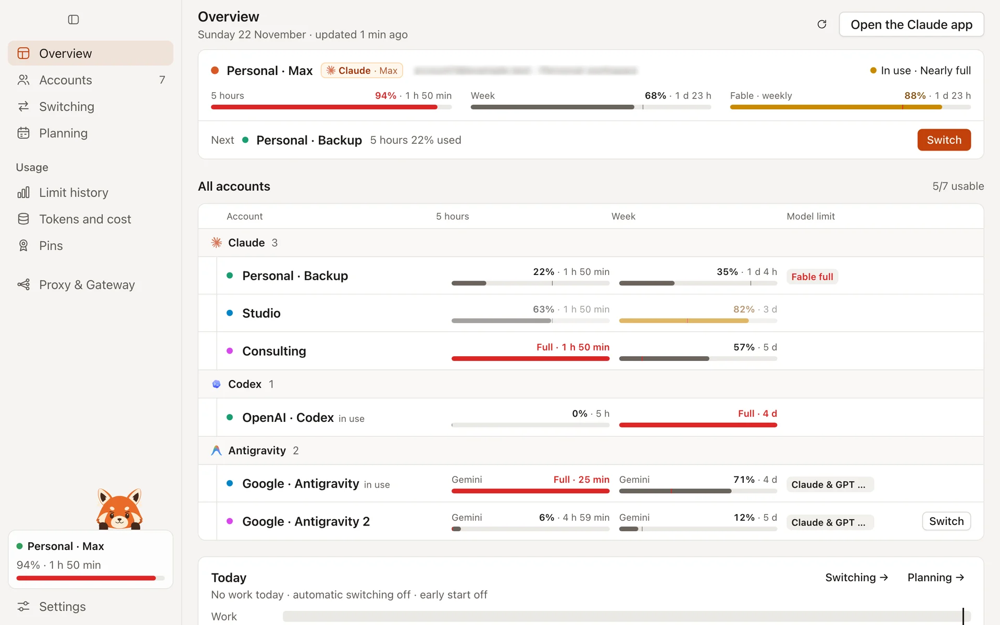
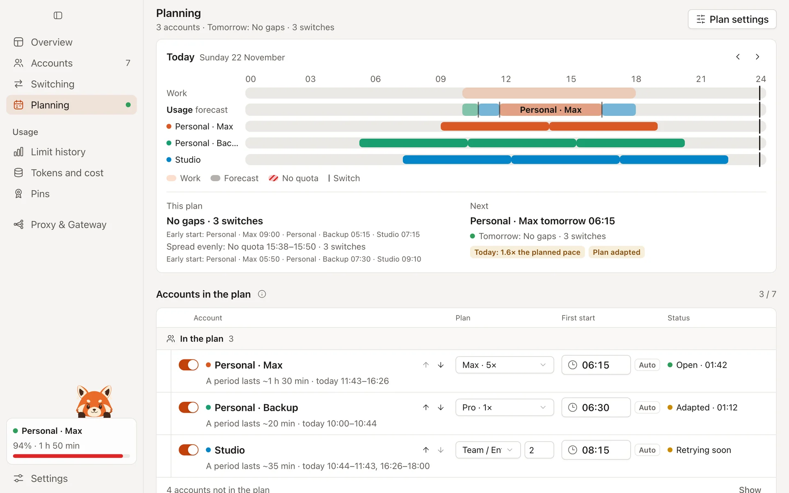
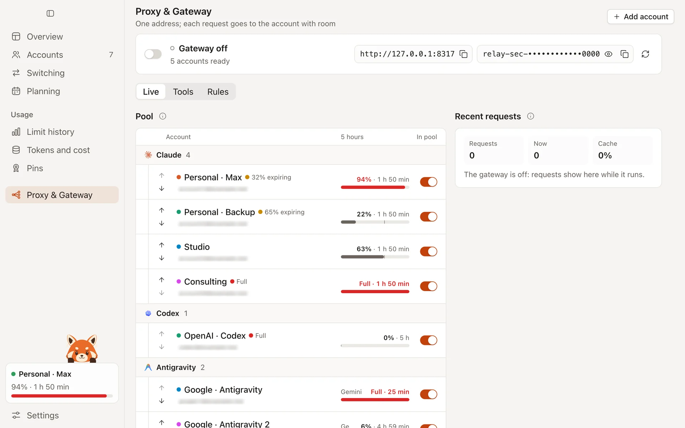

<div align="center">


# Relay

**Every Claude account, one menu-bar app.**<br>
Switch Claude Desktop between accounts, keep your Claude Code history on all of them,<br>
see every 5-hour and weekly limit at a glance, and let a local gateway spread the work.

[](https://github.com/ahmetcankacar54/relay/releases/latest)
[](https://github.com/ahmetcankacar54/relay/releases)
[](https://github.com/ahmetcankacar54/relay/actions/workflows/check.yml)
[](#install)
[](#platforms)
[](#15-languages)
[](LICENSE)

**English** · [Türkçe](README.tr.md) · [简体中文](README.zh-CN.md) · [日本語](README.ja.md) · [한국어](README.ko.md) · [Español](README.es.md)

[Download](#install) · [Features](#features) · [Privacy](#privacy--security) · [Terms & risk](#terms--risk) · [FAQ](#faq) · [CLI](cli/README.md)

<br>

<picture>
  <source media="(prefers-color-scheme: dark)" srcset="docs/images/overview-dark.webp">
  
</picture>

</div>

## Why Relay

If you have more than one Claude plan (a personal Pro or Max and a company Team or Enterprise seat, say), the Claude app only knows one of them at a time. Signing out and back in costs minutes, loses your Code tab's conversations, and you never know which account still has room.

Relay fixes that, from the menu bar:

- **One-click switch.** Relay quits the Claude app, puts the other account's saved sign-in back and reopens it. Nothing to retype, no browser dance.
- **Your Code history follows you.** Claude Code conversations and projects are merged across the accounts you choose, so the same conversation is there after every switch, with its permission mode.
- **Every limit, every account.** 5-hour, weekly and per-model (Opus, Fable) limits with reset times, for Claude, OpenAI Codex and Google Antigravity accounts, refreshed in the background.
- **A plan for your day.** Relay staggers each account's 5-hour windows across your work hours so the next account is ready before the current one runs out.
- **A gateway that spends the right account.** Point Claude Code, Codex CLI or omp at one local address; each request goes to the account with room, keeping sessions and caches on their account. It is off by default; read [Terms & risk](#terms--risk) before you turn it on.

Relay is free, open source (MIT), runs entirely on your Mac, and sends nothing to anyone but the services you already use.

## Install

| Platform | Download | Notes |
| --- | --- | --- |
| **macOS 13+** (Apple silicon) | [`Relay-<version>-arm64.dmg`](https://github.com/ahmetcankacar54/relay/releases/latest) | The main platform: menu-bar panel, widget, automatic switching. |
| **Windows 10/11** (x64) | [`Relay-Setup-<version>-x64.exe`](https://github.com/ahmetcankacar54/relay/releases/latest) | Switching by hand, limits, accounts, gateway. Experimental: not yet tested on a real machine. |
| **Linux** (x64) | [`Relay-<version>-x86_64.AppImage`](https://github.com/ahmetcankacar54/relay/releases/latest) | Works with the official Claude Desktop for Linux. |
| **CLI** (macOS) | `npm i -g @ahmetcankacar/relay` | `relay switch`, `relay usage`, `relay run` … see the [CLI guide](cli/README.md). |

Every release carries a `SHA256SUMS.txt` and updates itself from GitHub Releases.

> [!IMPORTANT]
> **Relay is signed with the author's own certificate but is not notarized by Apple.** The first time you open it, macOS blocks it once:
> 1. Drag **Relay** from the DMG into **Applications** and open it from there.
> 2. When macOS says it cannot verify Relay, click **Done**.
> 3. Open **System Settings → Privacy & Security**, find "Relay was blocked" and click **Open Anyway**.
>
> That is needed once per version. If macOS keeps asking, run `xattr -dr com.apple.quarantine /Applications/Relay.app`. The full walkthrough is in [INSTALL.txt](docs/share/install-notes.md).

## Quick start

| You have | Do this |
| --- | --- |
| The Claude app signed in to one account | **Accounts → Add account**. Relay saves that sign-in and finds Codex CLI sign-ins on this Mac too. |
| Another Claude account | **Add account → Sign in with another Claude account**. The Claude app opens on its sign-in screen; sign in and open Code once, and Relay saves it by itself. |
| Accounts added | Click **Switch** next to an account in the menu bar or the Overview. |
| Several accounts and a working day | **Planning** → choose the accounts and your work hours. |
| Claude Code or Codex CLI in a terminal | **Proxy & Gateway → Tools → Connect** points them at the gateway in one click (and back). |

## Features

### Accounts, grouped the way you think

<picture>
  <source media="(prefers-color-scheme: dark)" srcset="docs/images/accounts-dark.webp">
  
</picture>

- Claude, OpenAI Codex and Google Antigravity accounts in one list, grouped by provider and work group, sorted by name, 5-hour use or next reset; collapsed groups are remembered.
- One status per account (Ready, In use, Nearly full, Usage data is out of date…) and at most one action: switch, refresh or reconnect.
- Each account's connections in one place: the Claude app sign-in, the usage sign-in, the Claude browser extension and the terminal's `claude`.

### Switching that keeps your work

- **Switch** from the menu bar, the window, the widget or the CLI. It is a clean restart of the Claude app, after an encrypted backup of the files it changes; an interrupted switch can be restored.
- **Shared Code history**: conversations and local projects of the accounts you pick (also across companies) are merged at every switch. Deleted conversations stay deleted; the Bypass permission mode never travels.
- **Automatic switching** (optional): when you quit the Claude app, or — experimental, macOS — when the active account hits its limit, Relay picks the account with the most usable room, switches once and sends one continuation message to each conversation that stopped.
- Drafts you left unsent in the Claude app are saved at a switch, ready to copy back (on macOS Relay can type them back for you — experimental).

### Limits, history and cost

<picture>
  <source media="(prefers-color-scheme: dark)" srcset="docs/images/limits-dark.webp">
  
</picture>

- 5-hour and weekly use with reset times, per-model limits, plans (Pro, Max 5×, Max 20×, Team, Enterprise, ChatGPT Plus, Google AI Pro), and a pace mark on every bar.
- **Limit history**: full periods used, limit hits, when you work and how evenly your accounts share the load.
- **Tokens and cost**: Claude Code tokens per day, model and account, priced at API list prices.

### A planner for 5-hour windows

<picture>
  <source media="(prefers-color-scheme: dark)" srcset="docs/images/planning-dark.webp">
  
</picture>

- Relay simulates your day from your learned pace and each plan's size (a Max 20× counts 20 times a Pro), then picks start times that leave the fewest gaps with the fewest switches, spread across the day.
- **Early start** (optional, macOS and Linux) opens each account's window ahead of work so it resets when you need it, and keeps it running through your hours.
- The plan adapts during the day when you work faster or slower than usual, and knows when an account's week runs out.

### One gateway for every coding tool

<picture>
  <source media="(prefers-color-scheme: dark)" srcset="docs/images/proxy-dark.webp">
  
</picture>

- A local, key-protected endpoint for Claude Code, Codex CLI and omp. Requests go to the account whose week ends first and that still has room, compared in real capacity (a Max 20× at 85 % still has more room than a fresh Pro).
- Sessions stay on their account and its prompt cache; a busy account is drained at the start of a prompt, not in the middle.
- Listens only on this Mac, or on your Tailscale network if you choose.
- Off until you turn it on. It is the part of Relay furthest from ordinary use; see [Terms & risk](#terms--risk).

### Menu bar, widget and CLI


- **Menu-bar panel**: the account in use, its limits, the suggested next account and a one-click switch. Choose what the menu-bar title shows (5-hour use, time left, tokens or API value today).
- **Desktop widgets** (macOS): your account, all accounts, today and the last 7 days.
- **`relay` CLI**: `relay status`, `relay switch work`, `relay usage`, `relay run work` (Claude Code as that account), `relay tokens`, `relay proxy start`. `--json` for scripts.
- Everything is keyboard friendly: ⌘1–⌘8 for pages, ⌘K to search accounts, arrow keys through lists.

<br clear="right">

### 15 languages


English, Türkçe, Deutsch, Français, Español, Português (Brasil), Italiano, 日本語, 한국어, 简体中文, 繁體中文, Русский, Українська, Polski and Nederlands — in the app, the menu bar, the widget and the CLI. Relay follows your system language until you pick one in **Settings → General**.

## Platforms

| | macOS | Windows | Linux |
| --- | :---: | :---: | :---: |
| Switch the Claude app between accounts | ✅ | ✅ | ✅ |
| Shared Claude Code history | ✅ | ✅ | ✅ |
| Limits, history, tokens and cost | ✅ | ✅ | ✅ |
| Gateway for Claude Code / Codex CLI / omp | ✅ | ✅ | ✅ |
| Planner | ✅ | ✅ | ✅ |
| Early start of 5-hour windows | ✅ | — | ✅ |
| Automatic switch when you quit the Claude app | ✅ | — | ✅ |
| Switch and continue at the limit (experimental) | ✅ | — | — |
| Menu-bar panel, widget, `relay` CLI | ✅ | — | — |

macOS is the main platform. The Windows build has not been tested on a real machine yet; reports are welcome.

## Privacy & security

- **Local only.** Relay has no account, no server and **no telemetry or analytics**. Its data lives in `~/Library/Application Support/Relay` (macOS) or `~/.config/Relay` (Linux).
- **Who it talks to:** the services your accounts already use — `claude.ai`, `api.anthropic.com` (usage and profile), `chatgpt.com` / `api.openai.com` (Codex), `cloudcode-pa.googleapis.com` (Antigravity) — `api.github.com` for its own updates, and `github.com` to download a pinned helper (CLIProxyAPI, its SHA-256 checked) when Relay first needs it for an Antigravity account, and again after an update pins a new version.
- **Credentials** never reach the UI. Saved Claude app sign-ins are encrypted with a key kept in the macOS Keychain (Secret Service or KWallet on Linux). Files that hold the gateway key are written readable by you only.
- **The Claude app's files** are changed only while it is closed, after an encrypted backup and a write journal.
- **Hardened app:** sandboxed renderer windows, no developer tools in releases, only Relay's own pages can call into the app, and a strict content security policy.

Found a problem? Please report it privately — see [SECURITY.md](SECURITY.md).

## Terms & risk

Relay is unofficial, and some of what it does is not how Anthropic wants third-party tools to use Claude sign-ins. Please read this before you rely on it.

- **What Anthropic's terms say.** The [Claude Code legal and compliance page](https://code.claude.com/docs/en/legal-and-compliance#authentication-and-credential-use) says subscription sign-ins (Free, Pro, Max, Ultra) are for ordinary use of Claude Code and Anthropic's own apps; that third-party tools should not store, route or intermediate those sign-ins; and that advertised limits assume ordinary, individual use. Anthropic says it may enforce this without notice.
- **Anthropic's Usage Policy (in force from 12 November 2026).** The [Usage Policy](https://www.anthropic.com/legal/aup) says users must not "Resell, proxy, or otherwise provide access to Claude through unauthorized means, including services that route requests through consumer subscriptions or misrepresent the product or client being used." Two Relay features fall under this clause: the gateway with Claude subscription accounts routes requests through consumer subscriptions, and omp connected to the gateway sends its requests as Claude Code. Relay shows this clause and asks you to accept it before either one turns on; the `relay` CLI asks for `--yes`.
- **What Relay does.** Relay keeps your accounts' sign-ins on your computer, encrypted, so it can switch the Claude app and read limits. The gateway goes further: it sends Claude Code requests to your accounts with those sign-ins, and when omp is connected, omp's requests reach Claude in the same shape as Claude Code's.
- **What can happen.** Anthropic can block such requests, or limit or suspend an account that uses them. Relay cannot prevent that, and you use it at your own risk (see the [license](LICENSE)).
- **Where the risk sits.** Switching the Claude app and reading limits stay closest to ordinary use. The gateway is further from it, and omp through a Claude account is the furthest. The gateway is off until you turn it on; leave it off if you would rather not take that risk.
- **Work accounts.** A Team or Enterprise seat is also governed by your company's agreement with Anthropic. Ask your admin before you add one, and use only accounts that are yours.

**Google Antigravity.** Google's [Antigravity FAQ](https://antigravity.google/docs/faq) says that using third-party software to access Antigravity breaks its terms and can get an account suspended, and that automated account rotation is not supported on consumer plans; Google suspended accounts for this in February 2026. Relay is third-party software in that sense: it signs in to Antigravity and reads its limits, and its gateway can send requests through Antigravity accounts. An Antigravity account in Relay therefore carries the highest risk of all. Relay switches the Antigravity app only when you ask it to. Codex accounts are governed by OpenAI's terms.

## FAQ

<details>
<summary><b>Does Relay pool or extend my quota?</b></summary>

No. Each account keeps its own limits; Relay only switches which account the Claude app (or a request through the gateway) uses, and helps you use each one's time well. Use only accounts you are allowed to use, and read [Terms & risk](#terms--risk) first.
</details>

<details>
<summary><b>Is Relay made by Anthropic?</b></summary>

No. Relay is an independent, unofficial tool. It is not affiliated with, endorsed by or sponsored by Anthropic, OpenAI or Google. Claude is a trademark of Anthropic.
</details>

<details>
<summary><b>Will switching interrupt a running reply?</b></summary>

A switch restarts the Claude app, so a reply or subagent that is still running stops. Relay asks first, and automatic switching only acts when nothing is running. Conversations themselves are kept and continue after the switch.
</details>

<details>
<summary><b>Why does macOS say it cannot verify Relay?</b></summary>

Relay is not notarized by Apple yet. Follow the three steps in [Install](#install) once per version. Updates are checked against Relay's own certificate, so a tampered update is refused.
</details>

<details>
<summary><b>Can a Claude app update break Relay?</b></summary>

It can: Relay reads the Claude app's local files and, for automatic continuation, its accessibility tree. Relay checks what it finds before it changes anything, keeps a backup, and an interrupted switch can be restored from the app.
</details>

<details>
<summary><b>How do I uninstall it?</b></summary>

Quit Relay from the menu bar, move `Relay.app` to the Trash, and delete `~/Library/Application Support/Relay` if you also want your saved sign-ins gone. The Claude app keeps the account it was last switched to.
</details>

## Build from source

Requirements: Node.js 22.12+, and on macOS the Xcode Command Line Tools.

```sh
npm ci
npm run dev        # Electron + Vite
npm run dev:ui     # browser preview with sample accounts (?demo=50 for fifty)
npm test           # 3,000+ tests
npm run dist:mac:local   # signed local build (see docs/macos-local-signing.md)
```

How switching, history merging and usage reading work, signing and the Linux specifics are in [docs/development.md](docs/development.md). Contributions are welcome — bug reports, translations and pull requests alike. Copy follows [docs/ux/glossary.md](docs/ux/glossary.md); every UI string lives in [`shared/i18n/catalogs`](shared/i18n/catalogs).

## Star history

<a href="https://star-history.com/#ahmetcankacar54/relay&Date">
  <picture>
    <source media="(prefers-color-scheme: dark)" srcset="https://api.star-history.com/svg?repos=ahmetcankacar54/relay&type=Date&theme=dark">
    
  </picture>
</a>

## License

[MIT](LICENSE) © Ahmet Can Kaçar. Relay is an independent project and is not affiliated with Anthropic, OpenAI or Google.
