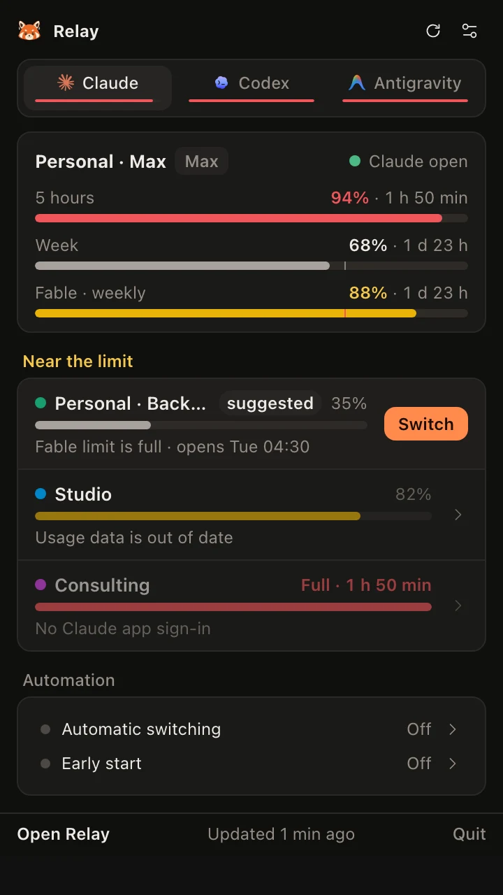

<div align="center">


# Relay

**Tüm Claude hesapların, tek bir menü çubuğu uygulamasında.**<br>
Claude uygulamasını hesaplar arasında geçir, Claude Code geçmişini hepsinde tut,<br>
her 5 saatlik ve haftalık limiti tek bakışta gör, işi yerel bir ağ geçidi paylaştırsın.

[](https://github.com/ahmetcankacar54/relay/releases/latest)
[](https://github.com/ahmetcankacar54/relay/releases)
[](https://github.com/ahmetcankacar54/relay/actions/workflows/check.yml)
[](#kurulum)
[](#platformlar)
[](#15-dil)
[](LICENSE)

[English](README.md) · **Türkçe** · [简体中文](README.zh-CN.md) · [日本語](README.ja.md) · [한국어](README.ko.md) · [Español](README.es.md)

[İndir](#kurulum) · [Özellikler](#özellikler) · [Gizlilik](#gizlilik-ve-güvenlik) · [Koşullar ve risk](#koşullar-ve-risk) · [SSS](#sss) · [CLI](cli/README.tr.md)

<br>

<picture>
  <source media="(prefers-color-scheme: dark)" srcset="docs/images/overview-dark.webp">
  
</picture>

</div>

## Neden Relay

Birden fazla Claude planın varsa (örneğin kişisel bir Pro veya Max ve şirketten bir Team ya da Enterprise koltuğu) Claude uygulaması aynı anda yalnızca birini tanır. Çıkış yapıp yeniden girmek dakikalar alır, Code sekmesindeki sohbetler kaybolur ve hangi hesabın hâlâ yeri olduğunu bilemezsin.

Relay bunu menü çubuğundan çözer:

- **Tek tıkla geçiş.** Relay Claude uygulamasını kapatır, diğer hesabın kayıtlı girişini geri koyar ve yeniden açar. Yeniden yazılacak şifre ya da tarayıcı turu yok.
- **Code geçmişin seninle gelir.** Seçtiğin hesapların Claude Code sohbetleri ve projeleri birleştirilir; her geçişten sonra aynı sohbet, izin moduyla birlikte orada olur.
- **Her hesabın her limiti.** Claude, OpenAI Codex ve Google Antigravity hesapları için 5 saatlik, haftalık ve modele özel (Opus, Fable) limitler, yenilenme zamanlarıyla, arka planda güncellenir.
- **Günün için bir plan.** Relay her hesabın 5 saatlik dönemlerini çalışma saatlerine yayar; biri dolmadan sıradaki hazır olur.
- **Doğru hesabı harcayan bir ağ geçidi.** Claude Code, Codex CLI veya omp'yi tek bir yerel adrese yönlendir; her istek yeri olan hesaba gider, oturumlar ve önbellekler kendi hesabında kalır. Varsayılan olarak kapalıdır; açmadan önce [Koşullar ve risk](#koşullar-ve-risk) bölümünü oku.

Relay ücretsizdir, açık kaynaktır (MIT), tamamen Mac'inde çalışır ve zaten kullandığın servisler dışında kimseye bir şey göndermez.

## Kurulum

| Platform | İndir | Not |
| --- | --- | --- |
| **macOS 13+** (Apple silicon) | [`Relay-<sürüm>-arm64.dmg`](https://github.com/ahmetcankacar54/relay/releases/latest) | Ana platform: menü çubuğu paneli, widget, otomatik geçiş. |
| **Windows 10/11** (x64) | [`Relay-Setup-<sürüm>-x64.exe`](https://github.com/ahmetcankacar54/relay/releases/latest) | Elle geçiş, limitler, hesaplar, ağ geçidi. |
| **Linux** (x64) | [`Relay-<sürüm>-x86_64.AppImage`](https://github.com/ahmetcankacar54/relay/releases/latest) | Linux için resmi Claude Desktop ile çalışır. |
| **CLI** (macOS) | `npm i -g @ahmetcankacar/relay` | `relay switch`, `relay usage`, `relay run` … [CLI rehberi](cli/README.tr.md). |

Her sürümde bir `SHA256SUMS.txt` vardır; Relay kendini GitHub Releases'tan günceller.

> [!IMPORTANT]
> **Relay geliştiricinin kendi sertifikasıyla imzalıdır ama Apple tarafından notarize edilmemiştir.** İlk açılışta macOS bir kez engeller:
> 1. **Relay**'i DMG'den **Uygulamalar** klasörüne sürükle ve oradan aç.
> 2. macOS Relay'i doğrulayamadığını söyleyince **Bitti**'ye tıkla.
> 3. **Sistem Ayarları → Gizlilik ve Güvenlik**'te "Relay engellendi" satırını bul ve **Yine de Aç**'a tıkla.
>
> Bu her sürümde bir kez gerekir. macOS sormaya devam ederse `xattr -dr com.apple.quarantine /Applications/Relay.app` çalıştır. Ayrıntılı anlatım [INSTALL.txt](docs/share/install-notes.md) içinde.

## Hızlı başlangıç

| Elinde | Yap |
| --- | --- |
| Tek hesapla girişli Claude uygulaması | **Hesaplar → Hesap ekle**. Relay o girişi kaydeder, bu Mac'teki Codex CLI girişlerini de bulur. |
| Başka bir Claude hesabı | **Hesap ekle → Başka bir Claude hesabıyla gir**. Claude uygulaması giriş ekranında açılır; gir ve Code'u bir kez aç, Relay kendisi kaydeder. |
| Eklenmiş hesaplar | Menü çubuğunda ya da Genel bakışta bir hesabın yanındaki **Geç**'e tıkla. |
| Birkaç hesap ve bir iş günü | **Planlama** → hesapları ve çalışma saatlerini seç. |
| Terminalde Claude Code veya Codex CLI | **Proxy ve Ağ Geçidi → Araçlar → Bağla** onları tek tıkla ağ geçidine yönlendirir (ve geri alır). |

## Özellikler

### Hesaplar, düşündüğün gibi gruplu

<picture>
  <source media="(prefers-color-scheme: dark)" srcset="docs/images/accounts-dark.webp">
  
</picture>

- Claude, OpenAI Codex ve Google Antigravity hesapları tek listede; sağlayıcıya ve çalışma grubuna göre gruplu, ada, 5 saat kullanımına ya da sonraki yenilenmeye göre sıralı. Kapattığın gruplar hatırlanır.
- Her hesap için tek durum (Hazır, Kullanımda, Dolmak üzere, Limit verisi eski…) ve en fazla bir işlem: geç, yenile ya da yeniden bağlan.
- Hesabın bağlantıları tek yerde: Claude uygulaması girişi, limit okuma girişi, Claude tarayıcı eklentisi ve terminaldeki `claude`.

### İşini koruyan geçiş

- Menü çubuğundan, pencereden, widget'tan ya da CLI'dan **geç**. Bu, değiştirdiği dosyaların şifreli yedeği alındıktan sonra Claude uygulamasının temiz bir yeniden başlatılmasıdır; yarıda kalan geçiş geri yüklenebilir.
- **Ortak Code geçmişi**: seçtiğin hesapların (şirketler arası da) sohbetleri ve yerel projeleri her geçişte birleştirilir. Silinen sohbetler silinmiş kalır; Bypass izin modu asla taşınmaz.
- **Otomatik geçiş** (isteğe bağlı): Claude uygulamasını kapattığında ya da — deneysel, macOS — kullanılan hesabın limiti dolduğunda Relay en çok yeri olan hesabı seçer, bir kez geçer ve duran her sohbete tek bir devam mesajı gönderir.
- Claude uygulamasında gönderilmeden kalan taslaklar geçişte kaydedilir, geri kopyalamaya hazırdır (macOS'ta Relay onları senin yerine yazabilir — deneysel).

### Limitler, geçmiş ve maliyet

<picture>
  <source media="(prefers-color-scheme: dark)" srcset="docs/images/limits-dark.webp">
  
</picture>

- Yenilenme zamanlarıyla 5 saatlik ve haftalık kullanım, modele özel limitler, planlar (Pro, Max 5×, Max 20×, Team, Enterprise, ChatGPT Plus, Google AI Pro) ve her çubukta tempo işareti.
- **Limit geçmişi**: kullanılan tam dönemler, limit dolmaları, ne zaman çalıştığın ve hesapların yükü ne kadar dengeli paylaştığı.
- **Token ve ücret**: günlük, modele ve hesaba göre Claude Code tokenları, API liste fiyatlarıyla.

### 5 saatlik dönemler için bir planlayıcı

<picture>
  <source media="(prefers-color-scheme: dark)" srcset="docs/images/planning-dark.webp">
  
</picture>

- Relay günü, öğrendiği temponla ve her planın büyüklüğüyle (Max 20× bir Pro'nun 20 katı sayılır) simüle eder; en az boşluk ve en az geçişle, güne yayılmış başlangıç saatleri seçer.
- **Önceden başlatma** (isteğe bağlı, macOS ve Linux) her hesabın dönemini işten önce açar, ihtiyaç duyduğunda yenilenmesini sağlar ve çalışma saatlerin boyunca açık tutar.
- Plan, gün içinde her zamankinden hızlı ya da yavaş çalıştığında uyarlanır ve bir hesabın haftasının ne zaman bittiğini bilir.

### Tüm kodlama araçları için tek ağ geçidi

<picture>
  <source media="(prefers-color-scheme: dark)" srcset="docs/images/proxy-dark.webp">
  
</picture>

- Claude Code, Codex CLI ve omp için yerel, anahtarla korunan tek bir uç nokta. İstekler haftası önce biten ve hâlâ yeri olan hesaba gider; yer gerçek kapasiteyle karşılaştırılır (%85 dolu bir Max 20×'in yeni bir Pro'dan daha çok yeri vardır).
- Oturumlar kendi hesabında ve istem önbelleğinde kalır; dolan bir hesap bir istemin ortasında değil başında boşaltılır.
- Yalnızca bu Mac'i ya da seçersen Tailscale ağını dinler.
- Sen açana kadar kapalıdır. Relay'in olağan kullanımdan en uzak parçası budur; bkz. [Koşullar ve risk](#koşullar-ve-risk).

### Menü çubuğu, widget ve CLI



- **Menü çubuğu paneli**: kullanılan hesap, limitleri, önerilen sıradaki hesap ve tek tıkla geçiş. Menü çubuğu başlığında ne görüneceğini seç (5 saat kullanımı, kalan süre, bugünkü token ya da API karşılığı).
- **Masaüstü widget'ları** (macOS): hesabın, tüm hesaplar, bugün ve son 7 gün.
- **`relay` CLI**: `relay status`, `relay switch is`, `relay usage`, `relay run is` (o hesapla Claude Code), `relay tokens`, `relay proxy start`. Betikler için `--json`.
- Klavyeyle rahat: sayfalar için ⌘1–⌘8, hesap aramak için ⌘K, listelerde ok tuşları.

<br clear="right">

### 15 dil


English, Türkçe, Deutsch, Français, Español, Português (Brasil), Italiano, 日本語, 한국어, 简体中文, 繁體中文, Русский, Українська, Polski ve Nederlands — uygulamada, menü çubuğunda, widget'ta ve CLI'da. Relay sen **Ayarlar → Genel**'den bir dil seçene kadar sistem dilini izler.

## Platformlar

| | macOS | Windows | Linux |
| --- | :---: | :---: | :---: |
| Claude uygulamasını hesaplar arasında geçirme | ✅ | ✅ | ✅ |
| Ortak Claude Code geçmişi | ✅ | ✅ | ✅ |
| Limitler, geçmiş, token ve ücret | ✅ | ✅ | ✅ |
| Claude Code / Codex CLI / omp için ağ geçidi | ✅ | ✅ | ✅ |
| Planlayıcı | ✅ | ✅ | ✅ |
| 5 saatlik dönemleri önceden başlatma | ✅ | — | ✅ |
| Claude uygulamasını kapatınca otomatik geçiş | ✅ | — | ✅ |
| Limit dolunca geç ve devam et (deneysel) | ✅ | — | — |
| Menü çubuğu paneli, widget, `relay` CLI | ✅ | — | — |

Ana platform macOS'tur. Windows sürümü henüz gerçek bir makinede denenmedi; geri bildirimler memnuniyetle karşılanır.

## Gizlilik ve güvenlik

- **Yalnızca yerel.** Relay'in hesabı, sunucusu ve **telemetrisi ya da analitiği yoktur**. Verileri `~/Library/Application Support/Relay` (macOS) ya da `~/.config/Relay` (Linux) içindedir.
- **Konuştuğu yerler:** hesaplarının zaten kullandığı servisler — `claude.ai`, `api.anthropic.com` (kullanım ve profil), `chatgpt.com` / `api.openai.com` (Codex), `cloudcode-pa.googleapis.com` (Antigravity) — ve kendi güncellemeleri için `api.github.com`.
- **Kimlik bilgileri** arayüze hiç ulaşmaz. Kayıtlı Claude uygulaması girişleri macOS Anahtar Zinciri'nde (Linux'ta Secret Service ya da KWallet) tutulan bir anahtarla şifrelenir. Ağ geçidi anahtarını içeren dosyalar yalnızca senin okuyabileceğin şekilde yazılır.
- **Claude uygulamasının dosyaları** yalnızca uygulama kapalıyken, şifreli bir yedek ve yazma günlüğünden sonra değiştirilir.
- **Sağlamlaştırılmış uygulama:** korumalı alanda çalışan pencereler, sürümlerde geliştirici araçları yok, uygulamaya yalnızca Relay'in kendi sayfaları erişebilir ve sıkı bir içerik güvenliği politikası.

Bir sorun mu buldun? Lütfen gizlice bildir — bkz. [SECURITY.md](SECURITY.md).

## Koşullar ve risk

Relay resmi değil ve yaptığı işlerin bir kısmı, Anthropic'in üçüncü taraf araçlardan Claude oturumlarını kullanma beklentisine uymuyor. Ona güvenmeden önce lütfen bunu oku.

- **Anthropic'in koşulları ne diyor?** [Claude Code yasal ve uyum sayfası](https://code.claude.com/docs/en/legal-and-compliance#authentication-and-credential-use), abonelik oturumlarının (Free, Pro, Max, Ultra) Claude Code'un ve Anthropic'in kendi uygulamalarının olağan kullanımı için olduğunu; üçüncü taraf araçların bu oturumları saklamaması, yönlendirmemesi ve aracılık etmemesi gerektiğini; duyurulan limitlerin olağan, bireysel kullanıma göre olduğunu söyler. Anthropic bunu haber vermeden uygulayabileceğini belirtir.
- **Relay ne yapıyor?** Relay, Claude uygulamasını hesaplar arasında geçirebilmek ve limitleri okuyabilmek için hesaplarının oturumlarını bilgisayarında, şifreli olarak saklar. Ağ geçidi bir adım daha ileri gider: Claude Code isteklerini bu oturumlarla hesaplarına gönderir; omp bağlıysa omp'nin istekleri de Claude'a Claude Code'unkilerle aynı biçimde ulaşır.
- **Ne olabilir?** Anthropic bu istekleri engelleyebilir ya da bunları kullanan bir hesabı kısıtlayabilir veya askıya alabilir. Relay bunu önleyemez; riski sen üstlenirsin (bkz. [lisans](LICENSE)).
- **Risk nerede?** Claude uygulamasını geçirmek ve limitleri okumak olağan kullanıma en yakın kısımdır. Ağ geçidi bundan daha uzaktır; omp'yi bir Claude hesabıyla kullanmak ise en uzağıdır. Ağ geçidi sen açana kadar kapalıdır; bu riski almak istemiyorsan kapalı bırak.
- **İş hesapları.** Team veya Enterprise koltukları şirketinin Anthropic ile yaptığı sözleşmeye de tabidir. Eklemeden önce yöneticine sor ve yalnızca sana ait hesapları kullan.

Codex ve Antigravity hesapları da aynı şekilde OpenAI'nin ve Google'ın koşullarına tabidir.

## SSS

<details>
<summary><b>Relay kotamı birleştirir ya da artırır mı?</b></summary>

Hayır. Her hesap kendi limitlerini korur; Relay yalnızca Claude uygulamasının (ya da ağ geçidinden geçen bir isteğin) hangi hesabı kullandığını değiştirir ve her birinin zamanını iyi kullanmana yardım eder. Yalnızca kullanma iznin olan hesapları kullan ve önce [Koşullar ve risk](#koşullar-ve-risk) bölümünü oku.
</details>

<details>
<summary><b>Relay'i Anthropic mi yaptı?</b></summary>

Hayır. Relay bağımsız, resmi olmayan bir araçtır. Anthropic, OpenAI ya da Google ile bağlantılı değildir, onlar tarafından desteklenmez. Claude, Anthropic'in ticari markasıdır.
</details>

<details>
<summary><b>Geçiş çalışan bir yanıtı keser mi?</b></summary>

Geçiş Claude uygulamasını yeniden başlatır, bu yüzden hâlâ çalışan bir yanıt ya da alt ajan durur. Relay önce sorar; otomatik geçiş yalnızca hiçbir şey çalışmıyorken davranır. Sohbetlerin kendisi korunur ve geçişten sonra devam eder.
</details>

<details>
<summary><b>macOS neden Relay'i doğrulayamadığını söylüyor?</b></summary>

Relay henüz Apple tarafından notarize edilmedi. [Kurulum](#kurulum)'daki üç adımı her sürümde bir kez uygula. Güncellemeler Relay'in kendi sertifikasıyla denetlenir; değiştirilmiş bir güncelleme reddedilir.
</details>

<details>
<summary><b>Bir Claude uygulaması güncellemesi Relay'i bozabilir mi?</b></summary>

Bozabilir: Relay Claude uygulamasının yerel dosyalarını ve otomatik devam için erişilebilirlik ağacını okur. Relay bir şeyi değiştirmeden önce bulduğunu denetler, yedek alır ve yarıda kalan bir geçiş uygulamadan geri yüklenebilir.
</details>

<details>
<summary><b>Nasıl kaldırırım?</b></summary>

Relay'i menü çubuğundan kapat, `Relay.app`'i Çöp Sepeti'ne taşı; kayıtlı girişlerin de silinsin istersen `~/Library/Application Support/Relay` klasörünü sil. Claude uygulaması en son geçtiği hesapta kalır.
</details>

## Kaynaktan derleme

Gereksinimler: Node.js 22.12+, macOS'ta Xcode Command Line Tools.

```sh
npm ci
npm run dev        # Electron + Vite
npm run dev:ui     # örnek hesaplarla tarayıcı önizlemesi (elli hesap için ?demo=50)
npm test           # 3.000+ test
npm run dist:mac:local   # imzalı yerel derleme (bkz. docs/macos-local-signing.md)
```

Geçişin, geçmiş birleştirmenin ve kullanım okumanın nasıl çalıştığı, imzalama ve Linux ayrıntıları [docs/development.md](docs/development.md) içinde (İngilizce). Katkılar memnuniyetle karşılanır — hata bildirimleri, çeviriler ve pull request'ler. Metinler [docs/ux/glossary.md](docs/ux/glossary.md) sözlüğüne uyar; arayüzdeki her metin [`shared/i18n/catalogs`](shared/i18n/catalogs) içindedir.

## Yıldız geçmişi

<a href="https://star-history.com/#ahmetcankacar54/relay&Date">
  <picture>
    <source media="(prefers-color-scheme: dark)" srcset="https://api.star-history.com/svg?repos=ahmetcankacar54/relay&type=Date&theme=dark">
    
  </picture>
</a>

## Lisans

[MIT](LICENSE) © Ahmet Can Kaçar. Relay bağımsız bir projedir; Anthropic, OpenAI ya da Google ile bağlantılı değildir.
