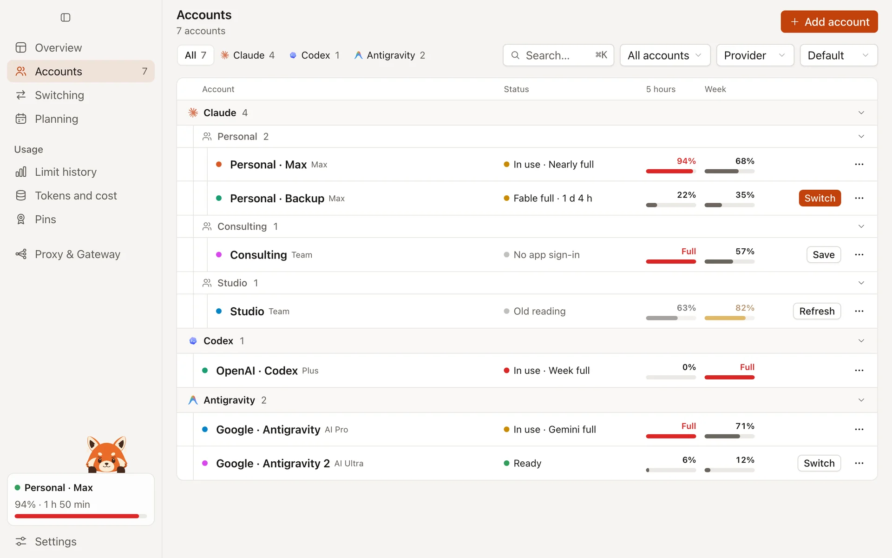

<div align="center">


# Relay

**所有 Claude 账号，一个菜单栏应用。**<br>
在多个账号之间切换 Claude Desktop，让每个账号都保留你的 Claude Code 历史，<br>
一眼看清每个 5 小时和每周限额，并让本地网关分摊工作。

[](https://github.com/ahmetcankacar54/relay/releases/latest)
[](https://github.com/ahmetcankacar54/relay/releases)
[](https://github.com/ahmetcankacar54/relay/actions/workflows/check.yml)
[](#安装)
[](#平台)
[](#15-种语言)
[](LICENSE)

[English](README.md) · [Türkçe](README.tr.md) · **简体中文** · [日本語](README.ja.md) · [한국어](README.ko.md) · [Español](README.es.md)

*本文为译文；以英文 README 为准，英文版可能更新。*

[下载](#安装) · [功能](#功能) · [隐私](#隐私与安全) · [条款与风险](#条款与风险) · [常见问题](#常见问题) · [CLI](cli/README.md)

<br>

<picture>
  <source media="(prefers-color-scheme: dark)" srcset="docs/images/overview-dark.webp">
  
</picture>

</div>

## 为什么用 Relay

如果你有不止一个 Claude 套餐（比如个人的 Pro 或 Max，加上公司的 Team 或 Enterprise 席位），Claude 应用一次只认得其中一个。退出再重新登录要花好几分钟，Code 标签页里的对话会丢失，而且你永远不知道哪个账号还有余量。

Relay 在菜单栏里解决这个问题：

- **一键切换。** Relay 退出 Claude 应用，放回另一个账号已保存的登录，然后重新打开它。无需重新输入，也不用在浏览器里来回折腾。
- **Code 历史跟着你走。** 你选定的账号之间会合并 Claude Code 对话和项目，所以每次切换后，同一段对话都还在，连同它的权限模式。
- **每个账号的每个限额。** Claude、OpenAI Codex 和 Google Antigravity 账号的 5 小时、每周和按模型（Opus、Fable）限额及重置时间，在后台刷新。
- **为你的一天做好规划。** Relay 把每个账号的 5 小时周期错开分布在你的工作时间里，让下一个账号在当前账号用完之前就已就绪。
- **用对账号的网关。** 把 Claude Code、Codex CLI 或 omp 指向一个本地地址；每个请求都会发往还有余量的账号，会话和缓存留在各自的账号上。网关默认关闭；开启前请先阅读[条款与风险](#条款与风险)。

Relay 免费、开源（MIT），完全在你的 Mac 上运行，除了你本来就在用的服务之外，不向任何人发送任何数据。

## 安装

| 平台 | 下载 | 说明 |
| --- | --- | --- |
| **macOS 13+**（Apple silicon） | [`Relay-<version>-arm64.dmg`](https://github.com/ahmetcankacar54/relay/releases/latest) | 主要平台：菜单栏面板、小组件、自动切换。 |
| **Windows 10/11**（x64） | [`Relay-Setup-<version>-x64.exe`](https://github.com/ahmetcankacar54/relay/releases/latest) | 手动切换、限额、账号、网关。实验性：尚未在真实机器上测试。 |
| **Linux**（x64） | [`Relay-<version>-x86_64.AppImage`](https://github.com/ahmetcankacar54/relay/releases/latest) | 配合官方 Claude Desktop for Linux 使用。 |
| **CLI**（macOS） | `npm i -g @ahmetcankacar/relay` | `relay switch`、`relay usage`、`relay run` … 见 [CLI 指南](cli/README.md)。 |

每个版本都附带 `SHA256SUMS.txt`，并通过 GitHub Releases 自动更新。

> [!IMPORTANT]
> **Relay 使用作者自己的证书签名，但未经 Apple 公证。** 第一次打开时，macOS 会拦截一次：
> 1. 把 **Relay** 从 DMG 拖到 **应用程序**，然后从那里打开。
> 2. macOS 提示无法验证 Relay 时，点击 **完成**。
> 3. 打开 **系统设置 → 隐私与安全性**，找到“Relay 已被阻止”的提示，点击 **仍要打开**。
>
> 每个版本只需这样做一次。如果 macOS 一直询问，运行 `xattr -dr com.apple.quarantine /Applications/Relay.app`。完整步骤见 [INSTALL.txt](docs/share/install-notes.md)。

## 快速上手

| 你的情况 | 这样做 |
| --- | --- |
| Claude 应用已登录一个账号 | **账号 → 添加账号**。Relay 会保存这个登录，并找到这台 Mac 上的 Codex CLI 登录。 |
| 另一个 Claude 账号 | **添加账号 → 用另一个 Claude 账号登录**。Claude 应用会在登录界面打开；登录并打开一次 Code，Relay 会自动保存。 |
| 已添加账号 | 在菜单栏或概览中点击账号旁边的 **切换**。 |
| 多个账号和一个工作日 | **规划** → 选择账号和你的工作时间。 |
| 终端里的 Claude Code 或 Codex CLI | **代理与网关 → 工具 → 连接** 一键把它们指向网关（也能一键改回）。 |

## 功能

### 账号，按你的思路分组

<picture>
  <source media="(prefers-color-scheme: dark)" srcset="docs/images/accounts-dark.webp">
  
</picture>

- Claude、OpenAI Codex 和 Google Antigravity 账号在同一个列表中，按提供商和工作组分组，可按名称、5 小时用量或下次重置排序；折叠的分组会被记住。
- 每个账号只有一个状态（就绪、使用中、即将用满、用量数据已过期…），最多一个操作：切换、刷新或重新连接。
- 每个账号的连接集中在一处：Claude 应用登录、用量登录、Claude 浏览器扩展和终端里的 `claude`。

### 不打断工作的切换

- 从菜单栏、窗口、小组件或 CLI **切换**。切换是对 Claude 应用的一次干净重启，事先会加密备份它要改动的文件；中断的切换可以恢复。
- **共享 Code 历史**：你选定的账号（也可以跨公司）的对话和本地项目会在每次切换时合并。已删除的对话保持删除；Bypass 权限模式永远不会被带过去。
- **自动切换**（可选）：当你退出 Claude 应用时，或者——实验性功能，仅 macOS——当前账号达到限额时，Relay 会选出可用余量最多的账号，切换一次，并向每个中断的对话发送一条继续消息。
- 你在 Claude 应用中未发送的草稿会在切换时保存下来，方便复制回去（在 macOS 上 Relay 可以替你重新输入——实验性功能）。

### 限额、历史和费用

<picture>
  <source media="(prefers-color-scheme: dark)" srcset="docs/images/limits-dark.webp">
  
</picture>

- 带重置时间的 5 小时和每周用量、按模型限额、套餐（Pro、Max 5×、Max 20×、Team、Enterprise、ChatGPT Plus、Google AI Pro），每个进度条上都有节奏标记。
- **限额历史**：用满的完整周期、触及限额的次数、你的工作时间，以及各账号分担负载的均衡程度。
- **Token 与费用**：按天、模型和账号统计的 Claude Code token，按 API 标价计价。

### 5 小时周期规划器

<picture>
  <source media="(prefers-color-scheme: dark)" srcset="docs/images/planning-dark.webp">
  
</picture>

- Relay 根据学到的你的节奏和每个套餐的大小（一个 Max 20× 按 20 个 Pro 计算）模拟你的一天，然后选出空档最少、切换最少、在一天中分布开的开始时间。
- **提前启动**（可选，macOS 和 Linux）在工作开始前打开每个账号的周期，使它在你需要时正好重置，并在你的工作时间内保持运行。
- 当你比平时工作得更快或更慢时，计划会在一天中自动调整，并且知道某个账号的本周额度何时用完。

### 所有编程工具共用一个网关

<picture>
  <source media="(prefers-color-scheme: dark)" srcset="docs/images/proxy-dark.webp">
  
</picture>

- 为 Claude Code、Codex CLI 和 omp 提供的本地端点，受密钥保护。请求会发往本周最先结束且仍有余量的账号，余量按实际容量比较（用了 85% 的 Max 20× 仍比全新的 Pro 余量更多）。
- 会话留在自己的账号和它的提示缓存上；繁忙的账号会在一次提示开始时被移出，而不是在中途。
- 只监听这台 Mac，或者在你选择时监听你的 Tailscale 网络。
- **溢出到 API 密钥。** 所有订阅账号都达到限额时，Claude 请求可以改走 API 密钥而不是失败：Anthropic API、OpenRouter、DeepSeek、Kimi、GLM 或任何兼容 Anthropic 的 URL，按你设定的顺序使用。每个请求的费用会显示在请求列表中，达到以美元计的每日上限后，当天剩余时间不再溢出。密钥像登录信息一样加密保存，从不完整显示。API 密钥按 token 计费，本就用于这种场景，因此溢出不带订阅账号的风险。Codex 请求从不溢出。
- 在你开启之前一直关闭。这是 Relay 中离常规使用最远的部分；见[条款与风险](#条款与风险)。

### 菜单栏、小组件和 CLI


- **菜单栏面板**：当前使用的账号、它的限额、建议的下一个账号和一键切换。可以选择菜单栏标题显示的内容（5 小时用量、剩余时间、今天的 token 或 API 等值）。
- **桌面小组件**（macOS）：你的账号、所有账号、今天和最近 7 天。
- **`relay` CLI**：`relay status`、`relay switch work`、`relay usage`、`relay run work`（以该账号运行 Claude Code）、`relay tokens`、`relay proxy start`。脚本可用 `--json`。
- 全程支持键盘操作：⌘1–⌘8 切换页面，⌘K 搜索账号，方向键浏览列表。

<br clear="right">

### 15 种语言


English、Türkçe、Deutsch、Français、Español、Português (Brasil)、Italiano、日本語、한국어、简体中文、繁體中文、Русский、Українська、Polski 和 Nederlands——覆盖应用、菜单栏、小组件和 CLI。在你于 **设置 → 通用** 中选择语言之前，Relay 会跟随系统语言。

## 平台

| | macOS | Windows | Linux |
| --- | :---: | :---: | :---: |
| 在账号之间切换 Claude 应用 | ✅ | ✅ | ✅ |
| 共享 Claude Code 历史 | ✅ | ✅ | ✅ |
| 限额、历史、token 和费用 | ✅ | ✅ | ✅ |
| 适用于 Claude Code / Codex CLI / omp 的网关 | ✅ | ✅ | ✅ |
| 规划器 | ✅ | ✅ | ✅ |
| 提前启动 5 小时周期 | ✅ | — | ✅ |
| 退出 Claude 应用时自动切换 | ✅ | — | ✅ |
| 达到限额时切换并继续（实验性） | ✅ | — | — |
| 菜单栏面板、小组件、`relay` CLI | ✅ | — | — |

macOS 是主要平台。Windows 版本尚未在真机上测试过；欢迎反馈。

**资源占用：**在菜单栏中空闲时，Relay 的所有进程合计占用约 0.1% 的 CPU、约 395 MB 内存（最多 435 MB）；窗口在前台打开时约占 2% 的 CPU；且不会弹出钥匙串授权提示（Apple 芯片 Mac；[测量方法](docs/development.md#resource-use)）。

## 隐私与安全

- **仅在本地运行。** Relay 没有账号体系、没有服务器，**也没有遥测或分析**。它的数据保存在 `~/Library/Application Support/Relay`（macOS）或 `~/.config/Relay`（Linux）。
- **它会连接的地方：** 你的账号本来就在使用的服务——`claude.ai`、`api.anthropic.com`（用量和个人资料）、`chatgpt.com` / `api.openai.com`（Codex）、`cloudcode-pa.googleapis.com`（Antigravity）——用于自身更新的 `api.github.com`，以及 `github.com`：在 Relay 首次为 Antigravity 账号需要时，以及更新固定了新版本时，下载一个固定版本、经 SHA-256 校验的辅助工具（CLIProxyAPI）。
- **凭据** 永远不会到达界面。已保存的 Claude 应用登录使用保存在 macOS 钥匙串（Keychain）中的密钥加密（Linux 上为 Secret Service 或 KWallet）。保存网关密钥的文件写入时设为仅你本人可读。
- **Claude 应用的文件** 只会在应用关闭时修改，且事先会做加密备份并记录写入日志。
- **加固的应用：** 渲染窗口运行在沙盒中，发布版本不含开发者工具，只有 Relay 自己的页面能调用应用，并启用严格的内容安全策略。

发现问题？请私下报告——见 [SECURITY.md](SECURITY.md)。

## 条款与风险

Relay 不是官方工具，它的部分做法并不是 Anthropic 希望第三方工具使用 Claude 登录的方式。在依赖它之前，请先阅读本节。

- **Anthropic 的条款怎么说。** [Claude Code 法律与合规页面](https://code.claude.com/docs/en/legal-and-compliance#authentication-and-credential-use)指出：订阅登录（Free、Pro、Max、Ultra）用于 Claude Code 和 Anthropic 自家应用的常规使用；第三方工具不应存储、路由或中转这些登录；公布的限额以常规的个人使用为前提。Anthropic 表示可能会在不另行通知的情况下执行这些规定。
- **Anthropic 使用政策（自 2026 年 11 月 12 日起生效）。** [使用政策](https://www.anthropic.com/legal/aup)禁止用户："Resell, proxy, or otherwise provide access to Claude through unauthorized means, including services that route requests through consumer subscriptions or misrepresent the product or client being used."（转售、代理或以其他未经授权的方式提供对 Claude 的访问，包括通过消费者订阅转发请求或冒充所用产品或客户端的服务。）Relay 有两项功能属于这一条款：使用 Claude 订阅账号的网关通过消费者订阅转发请求；连接到网关的 omp 以 Claude Code 的身份发送请求。在开启其中任何一项之前，Relay 会显示这一条款并请你确认；`relay` CLI 需要 `--yes`。
- **Relay 做了什么。** Relay 在你的电脑上以加密方式保存你各账号的登录，以便切换 Claude 应用和读取限额。网关更进一步：它使用这些登录把 Claude Code 请求发送到你的账号；连接 omp 时，omp 的请求会以与 Claude Code 请求相同的形式到达 Claude。
- **可能发生什么。** Anthropic 可以拦截此类请求，也可以限制或暂停使用这些请求的账号。Relay 无法阻止这种情况，使用风险由你自行承担（见[许可证](LICENSE)）。
- **风险在哪里。** 切换 Claude 应用和读取限额最接近常规使用。网关离常规使用更远，而通过 Claude 账号使用 omp 是最远的。网关在你开启之前一直关闭；如果你不想承担这种风险，请保持关闭。
- **工作账号。** Team 或 Enterprise 席位还受你公司与 Anthropic 之间协议的约束。添加之前请先询问你的管理员，并且只使用属于你自己的账号。

**Google Antigravity。** Google 的 [Antigravity 常见问题](https://antigravity.google/docs/faq) 指出，使用第三方软件访问 Antigravity 违反其条款，可能导致账号被停用，并且个人方案不支持自动轮换账号；Google 曾在 2026 年 2 月因此停用账号。从这个意义上说，Relay 就是第三方软件：它会登录 Antigravity 并读取其限额，其网关也可以通过 Antigravity 账号发送请求。因此，Relay 中的 Antigravity 账号风险最高。只有在你要求时，Relay 才会切换 Antigravity 应用。Codex 账号受 OpenAI 条款约束。

## 常见问题

<details>
<summary><b>Relay 会合并或扩大我的配额吗？</b></summary>

不会。每个账号保留各自的限额；Relay 只是切换 Claude 应用（或经过网关的请求）使用哪个账号，并帮助你用好每个账号的时间。只使用你有权使用的账号，并请先阅读[条款与风险](#条款与风险)。
</details>

<details>
<summary><b>Relay 是 Anthropic 出品的吗？</b></summary>

不是。Relay 是一个独立的非官方工具，与 Anthropic、OpenAI 或 Google 没有关联，也未获得它们的认可或赞助。Claude 是 Anthropic 的商标。
</details>

<details>
<summary><b>切换会打断正在生成的回复吗？</b></summary>

切换会重启 Claude 应用，所以仍在运行的回复或子代理会停止。Relay 会先询问你，自动切换也只在没有任务运行时才会执行。对话本身会保留，并在切换后继续。
</details>

<details>
<summary><b>为什么 macOS 提示无法验证 Relay？</b></summary>

Relay 目前尚未经过 Apple 公证。每个版本按照[安装](#安装)中的三个步骤操作一次即可。更新会用 Relay 自己的证书校验，被篡改的更新会被拒绝。
</details>

<details>
<summary><b>Claude 应用更新会让 Relay 失效吗？</b></summary>

有可能：Relay 会读取 Claude 应用的本地文件，自动继续功能还会读取它的辅助功能树。Relay 在修改任何内容之前都会先检查读到的内容，并保留备份；中断的切换可以在应用中恢复。
</details>

<details>
<summary><b>如何卸载？</b></summary>

从菜单栏退出 Relay，把 `Relay.app` 移到废纸篓；如果还想删除已保存的登录，再删除 `~/Library/Application Support/Relay`。Claude 应用会保持最后一次切换到的账号。
</details>

## 从源码构建

要求：Node.js 22.12+；在 macOS 上还需要 Xcode Command Line Tools。

```sh
npm ci
npm run dev        # Electron + Vite
npm run dev:ui     # 使用示例账号的浏览器预览（?demo=50 生成五十个）
npm test           # 3000+ 个测试
npm run dist:mac:local   # 签名的本地构建（见 docs/macos-local-signing.md）
```

切换、历史合并和用量读取的工作原理，以及签名和 Linux 相关细节，见 [docs/development.md](docs/development.md)（英文）。欢迎贡献——无论是问题报告、翻译还是 pull request。文案遵循 [docs/ux/glossary.md](docs/ux/glossary.md)；所有界面字符串都在 [`shared/i18n/catalogs`](shared/i18n/catalogs) 中。

## Star 历史

<a href="https://star-history.com/#ahmetcankacar54/relay&Date">
  <picture>
    <source media="(prefers-color-scheme: dark)" srcset="https://api.star-history.com/svg?repos=ahmetcankacar54/relay&type=Date&theme=dark">
    
  </picture>
</a>

## 许可证

[MIT](LICENSE) © Ahmet Can Kaçar。Relay 是一个独立项目，与 Anthropic、OpenAI 或 Google 没有关联。
